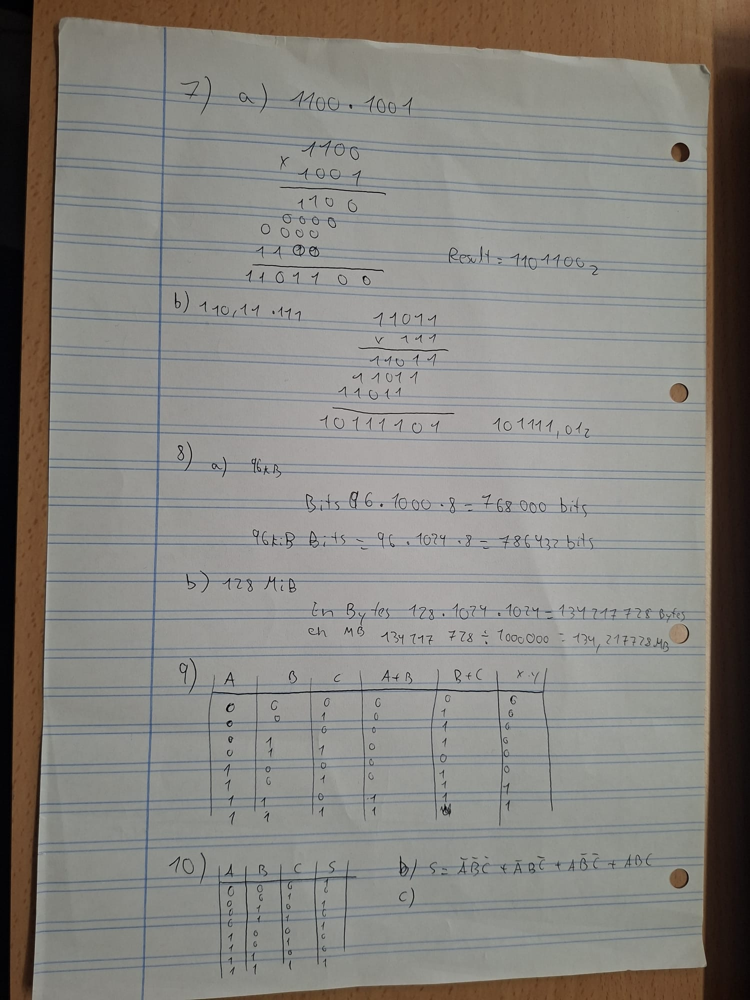
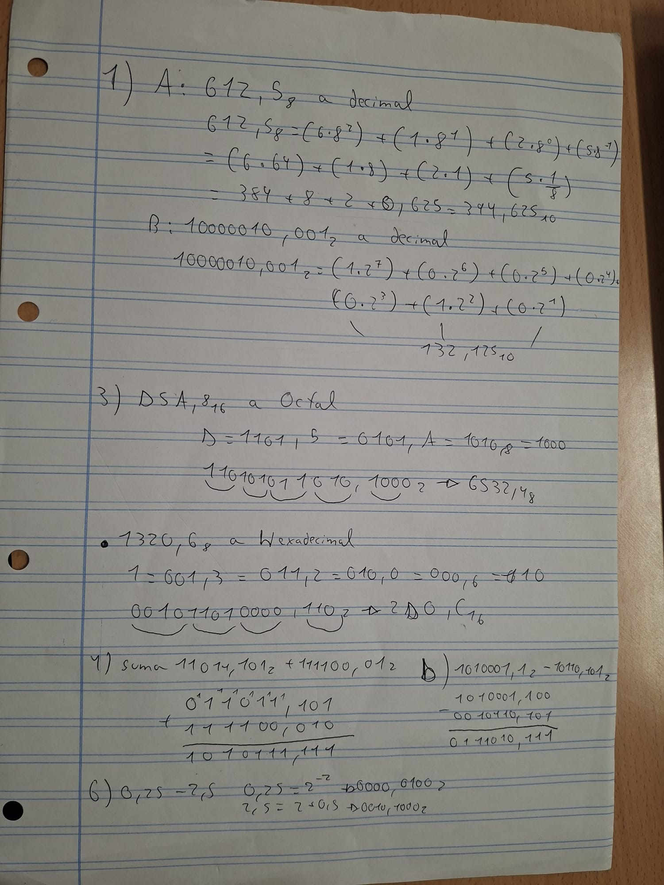
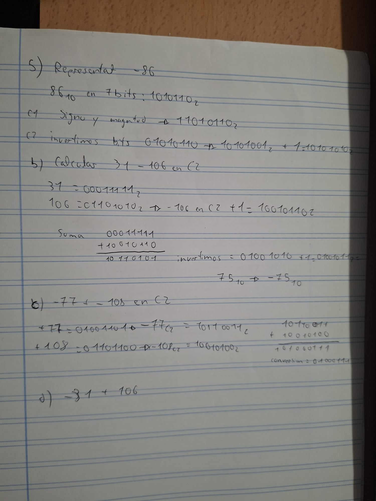

# Relacion de Ejercicios de Binario y de puestas Logicos

>@author: Adrian CM

## Relacion 10-

### Ejercicio 1

# Relacion de Ejercicios de Binario y de puestas Logicos

> @author: Adrian CM

## Relacion 10-

### Ejercicio 1

* Apartado A
* 394,625_10
* Apartado B
* 132,125_10

### Ejercicio 2

* Apartado a
* 10110011,1101_2 (Octal: 263,64_8 | Hexadecimal: B3,D_16)
* Apartado b
* 1111,001100_2 (No exacto, valor: 15,1875, error: 0,0125)

### Ejercicio 3

* Octal
* 6532,4_8
* Hexadecimal
* 2D0,C_16

### Ejercicio 4

* Apartado a
* 1010111,111_2 (87,875_10)
* Apartado b
* 111010,111_2 (58,875_10)

### Ejercicio 5

* Apartado a
* SM: 11010110_2 | C1: 10101001_2 | C2: 10101010_2
* Apartado b
* -75_10
* Apartado c
* Desbordamiento SÍ (resultado -185 fuera de rango)
* Apartado d
* 00000000 01001011_2 (+75_10)

### Ejercicio 6

* Suma C2
* 1301,1100_2
* Resultado decimal
* -2,25_10

### Ejercicio 7

* Apartado a
* 1101100_2 (108_10)
* Apartado b
* 101111,01_2 (47,25_10)
* Apartado c
* Izquierda: 000100010000_2 (272) | Derecha: 00001000_2 (8, resto 4)

### Ejercicio 8

* Apartado a
* 96 kB = 768.000 bits | 96 KiB = 786.432 bits
* Apartado b
* 134.217.728 Bytes (134,217728 MB)

### Ejercicio 9

(A B C | X=A·B | Y=B+C | S=X·Y)
(0 0 0 | 0 | 0 | 0)
(0 0 1 | 0 | 1 | 0)
(0 1 0 | 0 | 1 | 0)
(0 1 1 | 0 | 1 | 0)
(1 0 0 | 0 | 0 | 0)
(1 0 1 | 0 | 1 | 0)
(1 1 0 | 1 | 1 | 1)
(1 1 1 | 1 | 1 | 1)

* S vale 1 en las combinaciones 6 y 7 (1,1,0) y (1,1,1)

### Ejercicio 10

* Apartado a y b
* S = ĀB̄C̄ + ĀB̄C + AB̄C̄ + ABC (Tabla completada para combinaciones 0, 2, 4, 7)
* Apartado c y d
* S = ĀC̄ + B̄C̄ + ABC

